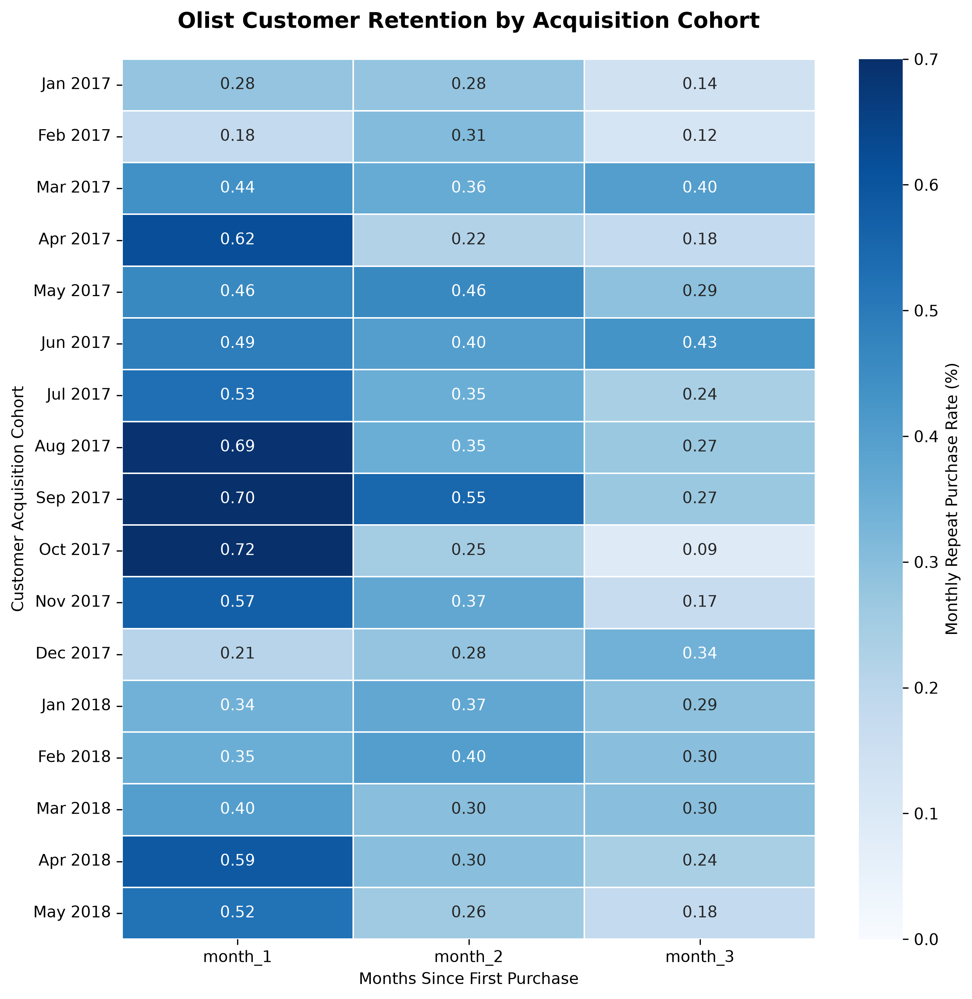
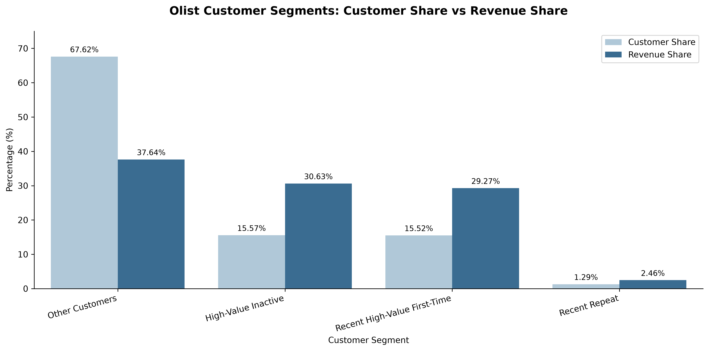

# Olist E-Commerce Customer Analytics

### Customer Segmentation, Purchasing Behavior and Retention Analysis

**Tools:** PostgreSQL | Python | pandas | seaborn | matplotlib | VS Code | Jupyter Notebook

## 1. Project Overview

Customer retention and purchasing behaviour are important drivers of long-term e-commerce performance. Understanding which customers return, how frequently they purchase, and how much they spend can help businesses identify opportunities to improve customer engagement and generate sustainable growth.

This project analyzes the publicly available Olist Brazilian E-Commerce Dataset to understand customer purchasing patterns, evaluate retention, and identify high-value customer segments.

Using PostgreSQL for data preparation and analysis, followed by Python for visualization, the project translates transactional data into actionable business insights.

## 2. Business Objectives

The analysis addresses four key questions:

1. How do customer orders and merchandise value change over time?
2. What proportion of customers make repeat purchases?
3. Which customer segments contribute disproportionately to merchandise value?
4. How does repeat-purchase behaviour vary across customer acquisition cohorts?

The overarching goal is to identify opportunities for customer retention and targeted marketing strategies.

## 3. Dataset

**Source:** [Olist Brazilian E-Commerce Public Dataset on Kaggle](https://www.kaggle.com/datasets/olistbr/brazilian-ecommerce)

The dataset contains historical Brazilian e-commerce transactions, including customer information, orders, order items, payments, products, sellers, reviews, and geolocation data.

Nine datasets were imported into PostgreSQL and organized into relational tables.

For the final customer analytics calculations, completed purchases were defined as orders with a `delivered` status and purchase timestamps before September 1, 2018.

This definition provides a consistent basis for customer purchasing behaviour analysis. Merchandise value excludes freight charges and is not equivalent to accounting-recognized revenue or profit.

## 4. Analytical Methodology

### Data Preparation and Validation

The analysis began by importing the source CSV files into PostgreSQL, defining table structures, and establishing relationships between customer, order, and product data.

Data validation included checking record counts, identifying unique customers, examining order statuses, and reviewing potential differences between all orders and delivered orders.

A reusable SQL view was created to standardize the completed-purchase definition across the final analyses.

### Purchasing Behaviour and Merchandise Value

SQL queries were used to evaluate monthly order volumes, merchandise value, average order value, repeat purchasing, and customer spending patterns.

### RFM Customer Segmentation

An adapted Recency, Frequency, Monetary (RFM) framework was used to evaluate customer behaviour.

- **Recency:** Days since a customer's most recent purchase, measured relative to September 1, 2018.
- **Frequency:** Number of distinct delivered orders.
- **Monetary Value:** Total merchandise value purchased, excluding freight.

Recency and monetary value were scored using quintiles. Frequency was simplified into one-time versus repeat purchasers.

Four mutually exclusive customer segments were defined:

- **Recent High-Value First-Time:** Recently active customers with one purchase and high merchandise value.
- **Recent Repeat:** Recently active customers with multiple purchases.
- **High-Value Inactive:** Customers with high historical merchandise value but relatively low recency scores.
- **Other Customers:** Customers who did not meet the preceding segment definitions.

### Cohort Retention Analysis

Customers were grouped into monthly acquisition cohorts based on their first delivered order.

Monthly repeat-purchase retention was calculated as the percentage of each cohort making at least one delivered purchase in a subsequent calendar month.

The final visualization covers January 2017 through May 2018 acquisition cohorts and examines Months 1, 2, and 3 after acquisition.

## 5. Key Findings

### Finding 1: Monthly Repeat Purchasing Is Low



Monthly repeat-purchase retention remained below 1% across the first three months after acquisition for every cohort examined.

The September and October 2017 cohorts recorded relatively strong Month 1 retention rates of 0.70% and 0.72%, respectively.

These results indicate that relatively few customers return to make another purchase in any individual month shortly after acquisition.

### Finding 2: High-Value Segments Contribute Disproportionately to Merchandise Value



The two high-value customer segments together represented **31.09% of analyzed customers but contributed 59.90% of delivered merchandise value**.

High-Value Inactive customers accounted for 15.57% of customers and 30.63% of merchandise value.

Recent High-Value First-Time customers accounted for 15.52% of customers and 29.27% of merchandise value.

These findings highlight the importance of understanding and engaging customers with high historical spending.

### Finding 3: Repeat Customers Represent a Small but Valuable Group

The Recent Repeat segment represented 1.29% of customers and contributed 2.46% of merchandise value.

This segment generated a larger share of merchandise value than its share of customers, suggesting that repeat purchasing is a potentially valuable behavior to encourage.

The Recent Repeat segment is a custom behavioral category and does not represent every repeat purchaser in the dataset.

## 6. Business Recommendations

**1. Investigate high-value customer reactivation**

Test targeted re-engagement initiatives for historically high-spending customers who have not purchased recently. Campaign effectiveness could be measured using incremental repeat-purchase rates and contribution margin.

**2. Encourage second purchases among high-value first-time customers**

Explore personalized post-purchase communications, relevant product recommendations, and carefully designed incentives to encourage a second purchase.

**3. Evaluate retention by customer and product characteristics**

Investigate whether repeat purchasing differs across product categories, order values, and customer characteristics to identify segments with stronger retention potential.

**4. Measure incremental impact before scaling**

Use controlled experiments to evaluate whether proposed retention interventions generate incremental purchases and sufficient financial returns to justify their costs.

## 7. Limitations

- The dataset is historical and may not reflect current customer behaviour.
- Delivered-order status is used as a proxy for completed purchases and does not establish whether orders were subsequently refunded or returned.
- Merchandise value is not equivalent to recognized revenue, profit, or customer lifetime value.
- Cohort retention measures purchasing activity within individual months rather than cumulative retention.
- RFM segmentation uses custom business rules rather than a standardized full five-level frequency scoring system.
- Observational patterns do not establish that proposed marketing interventions will improve retention.

## 8. Project Structure

```text
olist_customer_analytics/
│
├── data/
│   ├── cohort_retention.csv
│   └── rfm_segments.csv
│
├── notebooks/
│   └── olist_python_workflow.ipynb
│
├── sql/
│   ├── olist_queries.sql
│   └── PostgreSQL_queries.sql
│
├── visuals/
│   ├── olist_cohort_retention_heatmap.png
│   └── olist_rfm_segment_comparison.png
│
└── README.md
```

The `data` folder also contains the original Olist CSV datasets used for analysis.

## 9. Conclusion

This project demonstrates an end-to-end business analytics workflow, from relational database setup and SQL analysis to customer segmentation, cohort analysis, and Python visualization.

The findings highlight low monthly repeat-purchase activity and a concentration of merchandise value among high-value customer segments.

These results provide a foundation for further investigation into customer engagement, targeted retention initiatives, and data-driven marketing strategies.
